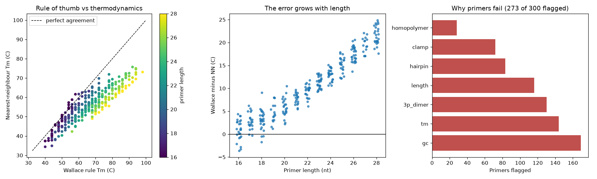

# Primer Tm & Dimer Checker

> The Wallace rule told you 64 C. The PCR failed anyway. Here's why.

## Demo Output



Produced from simulated primers by `demo.py`: rule-of-thumb Tm against nearest-neighbour Tm, how the error grows with length, and the most common reasons primers fail QC.

## Why This Exists

Most primer problems are dull and predictable: the melting temperature is off, the 3' end can't decide whether to bind template or itself, or there's a hairpin waiting to eat your yield. Primer3 handles all of this well, but it's a black box to most people who use it. This repo spells out each check in about 150 lines of plain Python, so you can see what is actually being scored.

## What Gets Checked

| Check | Rule used here | Why it matters |
|-------|----------------|----------------|
| Length | 18-25 nt | Specificity vs cost and synthesis errors |
| GC content | 40-60% | Extreme GC means unstable or sticky primers |
| Tm (nearest-neighbour) | 52-65 C, pair within 3 C | Both primers must anneal at one temperature |
| GC clamp | 1-3 G/C in the last 5 bases | Some 3' stability, but not too much |
| Homopolymer | fewer than 5 identical bases in a row | Slippage and mispriming |
| Hairpin | stem shorter than 4 bp | Primer folds on itself instead of binding |
| 3' self/cross-dimer | under 4 complementary bases at the 3' end | Primer-dimer: the classic band at 50 bp |

## Usage

```python
from primer_check import check_primer, check_pair
check_primer("AGCGTACCTGATTCGGAACG")
check_pair("AGCGTACCTGATTCGGAACG", "TTGCAGGTCAAGCTCCATCG")
```

Run `python demo.py` to regenerate the figure and `results/summary.csv`.

## When NOT to Use This

- **qPCR probes, degenerate primers or modified bases** need dedicated thermodynamic tables.
- **Mg2+ and dNTP corrections** are not modelled; only monovalent salt is. At high Mg2+, real Tm runs higher.
- **Genome-wide specificity** is not checked. A perfect primer that binds 40 places is not a perfect primer. Use Primer-BLAST.

## The Uncomfortable Truth

The Wallace rule is off by 5-10 C for typical 20-25-mers, and it can't see hairpins or dimers at all. Most "my PCR doesn't work" problems are primer problems you could have caught at the keyboard.

## Further Reading

- SantaLucia J. "A unified view of polymer, dumbbell, and oligonucleotide DNA nearest-neighbor thermodynamics." PNAS (1998).
- Untergasser A. et al. "Primer3 — new capabilities and interfaces." Nucleic Acids Research (2012).
